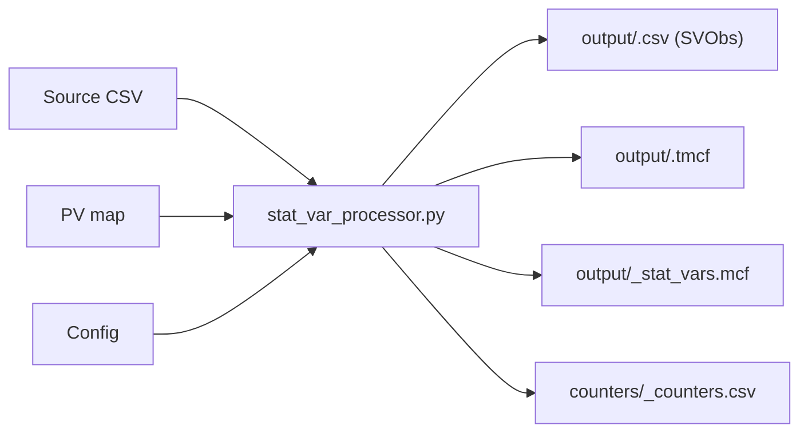

# StatVar Processor

`stat_var_processor.py` converts tabular source data into Data Commons
StatisticalVariables and observations, ready for the Data Commons import tool.

## Contents

- **Get started:** [Overview](#overview) · [Quick reference](#quick-reference) ·
  [Setup](#setup) · [Quick start](#quick-start)
- **Build an import:** [Write a PV map](#write-a-pv-map) ·
  [Write a config](#write-a-config) ·
  [Write PV maps that survive auto-refresh](#write-pv-maps-that-survive-auto-refresh)
  · [Map places](#map-places) ·
  [Add the processor to an import](#add-the-processor-to-an-import) ·
  [Create test data](#create-test-data)
- **Check and fix:** [Check the results](#check-the-results) ·
  [Common problems](#common-problems)
- **More:** [Related tools and docs](#related-tools-and-docs), including the
  [PV map guide](docs/pv_map.md),
  [Advanced processing](docs/advanced_processing.md),
  [Advanced configuration](docs/config.md), and
  [Troubleshooting](docs/troubleshooting.md)

## Overview

The processor reads a data file, looks up each column header and cell in a
property-value map, and emits the import files. It uses these terms:

- **StatVar** (StatisticalVariable): what is measured, for example
  `Count_Person_Female`, defined by properties such as `populationType: Person`
  and `gender: Female`.
- **SVObs** (StatVarObservation): one value of a StatVar for a place and date.
- **PV map** (property-value map): a schema config file that maps text in the
  source data to Data Commons schema properties and values.
- **Config**: a config file with processing settings, such as which rows are
  headers.
- **TMCF** (template MCF): maps the columns of the output CSV to SVObs
  properties.

The PV map and the config can be CSV, JSON, or Python dictionary files. This
guide uses CSV.



## Quick reference

Follow these steps for every new import. Each step ends with a check that tells
you it is done:

1. **Inspect the input.** Give every column a role: place, date, label (a
   category such as gender), value, or ignore. *Done when* every column has a
   role. Columns you ignore need no PV map entry.
1. **Write `<import>_pvmap.csv` and `<import>_statvar_processor_config.csv`.**
   See [Write a PV map](#write-a-pv-map) and [Write a config](#write-a-config).
   *Done when* every value column maps `value,{Number}` and the
   [mandatory properties](#mandatory-properties) are covered.
1. **Run on a sample** with `--input_rows=100` and
   `--output_counters=counters/<import>_counters.csv`. For large or long-format
   inputs, test on a sample with every indicator, category, and place instead;
   see the [data sampler guide](docs/data_sampler.md). *Done when* the command
   exits with code 0 and every `dropped-*` counter is 0 or explained.
1. **Check the output.** Read the counters, then trace 3 output rows back to the
   source with the `#input` column. *Done when* every
   [success check](#check-the-results) holds.
1. **Run in full and lint.** *Done when* the output row count is about (data
   rows × value columns) minus intentional drops, you have reviewed
   `_stat_vars.mcf`, and `dc-import lint` reports no errors.

## Setup

Run these commands from the repository root:

1. Create the Python environment (installs `requirements_all.txt` into `.env/`):

   ```bash
   ./run_tests.sh -r
   ```

1. Set a Data Commons API key. The processor calls `api.datacommons.org` on
   every run, so it needs internet access. Without your own key it uses a shared
   key that can fail with `429 Too Many Requests`. Get a key from the
   [Data Commons API docs](https://docs.datacommons.org/api/#obtain-an-api-key).

   ```bash
   export DC_API_KEY=<your-key>
   ```

   WARNING: The processor logs its full config at startup, including the API
   key. Don't commit or share run logs.

## Quick start

Run the bundled sample from the repository root:

```bash
./agents/common/run_python.sh tools/statvar_importer/stat_var_processor.py \
  --input_data=tools/statvar_importer/test_data/sample_input.csv \
  --pv_map=tools/statvar_importer/test_data/quickstart_pvmap.csv \
  --config_file=tools/statvar_importer/test_data/quickstart_statvar_processor_config.csv \
  --output_path=/tmp/svp/output/sample_output \
  --output_counters=/tmp/svp/counters/sample_counters.csv
```

The input, `test_data/sample_input.csv`, starts with title lines and has label
rows, such as `Count of all Males`, between the data rows:

```csv
Sample input for StatVarProcessor with headers lines that are ignored.
The file has columns that map to schema and data values.
County,Place Fips Code,Year,Person Age,Person Race,Total Persons,Fraction of Population
Kings County CA, 6223, 2020, 25-30, WH, 23456.0, 10.1
Count of all Males,,,,,,,
Orange County CA, 6123, 2020, 25-30, A-PI, 12345.0, 10.1
```

The PV map, `test_data/quickstart_pvmap.csv`, maps that text to schema. These
are a few of its rows:

```csv
#key,property-1,value-1,property-2,value-2
fips code,observationAbout,geoId/{Number}
year,observationDate,{Number}
males,gender,Male
total persons,value,{Number},populationType,Person
```

The run writes these files:

- `/tmp/svp/output/sample_output.csv`: the observations.
- `/tmp/svp/output/sample_output.tmcf`: the template for the CSV.
- `/tmp/svp/output/sample_output_stat_vars.mcf`: the generated StatVars.
- `/tmp/svp/counters/sample_counters.csv`: processing counters.

The first rows of the CSV look like this:

```csv
observationAbout,observationDate,variableMeasured,value,#input
geoId/6223,2020,dcid:Count_Person_25To30Years_WhiteAlone,23456,tools/statvar_importer/test_data/sample_input.csv:4:6
geoId/6223,2020,dcid:Count_Person_25To30Years_WhiteAlone_AsAFractionOf_Count_Person,10.1,tools/statvar_importer/test_data/sample_input.csv:4:7
```

## Write a PV map

A PV map is a schema config file, usually CSV. The first column is a **key**:
text that appears in the source data. The remaining columns are pairs of a
property and a value from the Data Commons schema that apply wherever the key
matches. Start the file with a `#key` header row; the `#` keeps the header from
matching text such as `key` in the source:

```csv
#key,property-1,value-1,property-2,value-2,property-3,value-3
<text in the source>,<property>,<value>,<property>,<value>,...
```

### Walkthrough

This input is part of `test_data/sample_input.csv`:

| County             | Place Fips Code | Year | Person Age | Person Race | Total Persons |
| ------------------ | --------------- | ---- | ---------- | ----------- | ------------- |
| Kings County CA    | 6223            | 2020 | 25-30      | WH          | 23456.0       |
| Count of all Males |                 |      |            |             |               |
| Orange County CA   | 6123            | 2020 | 25-30      | A-PI        | 12345.0       |

This excerpt of `test_data/quickstart_pvmap.csv` handles it (the full file also
maps `30-35`, `females`, and the fraction column):

```csv
#key,property-1,value-1,property-2,value-2
fips code,observationAbout,geoId/{Number}
year,observationDate,{Number}
25-30,age,25To30Years
wh,race,WhiteAlone
a-pi,race,AsianOrPacificIslander
males,gender,Male
total persons,value,{Number},populationType,Person
```

The processor matches the keys like this:

| Source text              | Key             | Result                                                                       |
| ------------------------ | --------------- | ---------------------------------------------------------------------------- |
| Header `Place Fips Code` | `fips code`     | Each cell below sets `observationAbout`, e.g. `geoId/6223`                   |
| Header `Year`            | `year`          | Each cell below sets `observationDate`, e.g. `2020`                          |
| Cell `25-30`, `WH`       | `25-30`, `wh`   | Adds `age` and `race` to the values in that row                              |
| Row `Count of all Males` | `males`         | Adds `gender: Male` to the rows below it                                     |
| Header `Total Persons`   | `total persons` | Each cell below is an SVObs value of a StatVar with `populationType: Person` |

The schema properties that apply to a value, other than the observation
properties, define its StatVar. The processor generates each StatVar and its
DCID and writes it to `_stat_vars.mcf`. The first data row becomes the StatVar
`Count_Person_25To30Years_WhiteAlone` (properties `populationType: Person`,
`measuredProperty: count` by default, `age: 25To30Years`, and
`race: WhiteAlone`) with the observation `2020, geoId/6223, 23456`.

### Matching rules

The processor applies keys with these rules:

1. **It looks up header text and cell text.** Column header PVs apply to every
   cell below the header. Cell PVs apply to the other values in the same row. A
   row with only a label and no observation values, such as
   `Count of all Males`, applies to the rows below it when `header_rows` is left
   unset (see [Write a config](#write-a-config)).

1. **Keys match whole words.** `man` doesn't match `woman`.

1. **The longest matching key wins**, and keys that match different parts of the
   text combine: `total persons` and `males` can both apply.

1. **Case.** The processor tries the whole text first, then parts of it, as
   written and then in lowercase. A lowercase key therefore matches text in any
   case: `total persons` matches `Total Persons` and `TOTAL PERSONS`, and
   `fips code` matches inside `Place Fips Code`. Use lowercase keys when they
   don't clash with other text in the source, so the PV map keeps working if the
   source changes its capitalization. Exception: in long text, such as
   sentence-length indicator names, the processor searches for each key as
   written. Copy the source casing for those keys (for example `pulmonary TB`),
   or set `match_substring_word_boundary` off. See
   [How keys match](docs/pv_map.md#how-keys-match).

### References and local variables

Values can refer to the cell being processed:

- `{Number}`: the numeric value of the cell, for example
  `observationDate,{Number}`.
- `{Data}`: the text of the cell, for example `observationAbout,country/{Data}`.
- Capitalized properties, such as `ProductName`, are local variables. Use them
  to copy a cell's value into other properties of the same row, for example
  `{ProductName}` in a `name`. From a header or label row, they carry into the
  rows below it. They never appear in the output.

### Mandatory properties

Every StatVar needs `populationType` and `measuredProperty`. `measuredProperty`
defaults to `count` and `statType` to `measuredValue`, so you usually set only
`populationType`. Every SVObs needs `observationAbout`, `observationDate`, and
`value`. The processor drops output that lacks them.

### Dates

Map the date column directly: `year,observationDate,{Number}` for years, or
`date,observationDate,{Data}` for full dates. The processor normalizes common
formats to ISO 8601 (`YYYY`, `YYYY-MM`, `YYYY-MM-DD`). For other formats, parse
dates with `#Eval`; see [Parse dates](docs/advanced_processing.md#parse-dates).

### Drop data

Drop a whole row by mapping a label in the row to `#ignore` with a reason, for
example `tot,#ignore,total is computed in Data Commons`. Write `#ignore` in
lowercase.

A column without a `value` mapping produces no observations, so a value column
you don't map is skipped.

Comment out a row with a leading `#` to remove its mapping, for example to keep
an alternative while you test:

```csv
# moe alternatives
#margin of error,value,{Number},statType,marginOfError
```

NOTE: Write comments in the first column only, keep them to a few words, and
leave out commas. A comma starts a new column, which is read as a property or a
value. A long comment in the first column changes how keys match: in testing,
one 22-word comment row stopped every lowercase key from matching.

Need filters, scaling, aggregation, or computed values? See
[Advanced processing](docs/advanced_processing.md). For the full PV map
reference, see [PV map guide](docs/pv_map.md). To find existing schema for a
label, see `schema_matcher.py` in [Schema tools](schema/README.md). To generate
a PV map automatically, see
[tools/agentic_import](https://github.com/datacommonsorg/data/tree/master/tools/agentic_import).

## Write a config

The config is a two-column CSV with a `parameter,value` header (JSON and Python
dictionary files also work). Quote values that contain commas. A minimal config
for a tidy CSV with one header row and the label columns first looks like this:

```csv
parameter,value
import_name,US_County_Population
url,https://www.example.gov/population-data
description,"County population by age, race, and gender"
release_frequency,annual
start_date,2010
process,"Download the yearly CSV, aggregate genders to get totals, then run the processor"
header_rows,1
mapped_columns,3
output_columns,"observationAbout,observationDate,variableMeasured,value,#input"
```

The first rows describe the import: its name in CamelCase, source URL,
description, release frequency, first date, and processing steps. Leave out an
end date so the config keeps working as the import refreshes. In `process`, call
out any extra processing, such as aggregating genders to get totals. Fill these
in so reviewers understand the source and the processing.

The processing settings work like this:

- `header_rows,1`: line 1 of the file holds the column headers, and their text
  is looked up in the PV map. The count starts at the top of the file and
  includes title lines: if the headers are on line 3, set `header_rows,3`.
- `mapped_columns,3`: cell values in the first 3 columns are looked up. Value
  cells in the other columns aren't. If you set neither `mapped_columns` nor
  `mapped_rows`, every cell is looked up. Set `mapped_columns` only together
  with `header_rows`; without `header_rows`, no header is found and the output
  is empty.
- `output_columns`: the CSV columns, in order. Always set it so the CSV and TMCF
  stay the same across runs, and end it with `#input`. Add `unit`,
  `scalingFactor`, `measurementMethod`, or `observationPeriod` when your data
  sets them.
- `input_rows`: process only the first N rows. Use it for sample runs.

Some files have title lines and rows with only a label that apply to the rows
below them, as `test_data/sample_input.csv` does. For these, leave `header_rows`
and `mapped_columns` unset, and the processor finds the header and label rows
itself. The quick-start config works this way.

If your sheet has header rows inside the data, see `#Header` in
[Advanced processing](docs/advanced_processing.md). For other settings, see the
[advanced configuration](docs/config.md).

## Write PV maps that survive auto-refresh

Imports refresh automatically when the source publishes new data. Follow these
rules so new releases process without edits:

1. **Use lowercase keys for whole-cell text**, such as `total persons`, so a
   change in the source's capitalization still matches.
1. **Give every `#ignore` a reason**, such as
   `tot,#ignore,total is computed in Data Commons`.
1. **Add expected future keys now**: upcoming years, if years are keys, and
   places likely to appear.
1. **Split the PV map into reusable files**, for example a
   `<source>_places_pvmap.csv` shared by all tables from the same source plus a
   topic PV map per table. Pass both:
   `--pv_map=<source>_places_pvmap.csv,<table>_pvmap.csv`. When two files map
   the same key, the file loaded last wins; see
   [Advanced configuration](docs/config.md#pv-maps-with-the-same-key).
1. **Keep filters and date ranges explicit.** Don't hard-code a future-year
   cutoff, such as a filter that drops years after 2024.

## Map places

Put place mappings in a places PV map, `<source>_places_pvmap.csv`, that every
table from the same source can reuse:

```csv
#key,property-1,value-1
# codes
iso3,observationAbout,country/{Data}
# names
kings county ca,observationAbout,geoId/06031
# georgia: US state chosen, the source lists US states
georgia,observationAbout,geoId/13
#georgia,observationAbout,country/GEO
```

The rows follow these rules:

- Map a column of codes with one pattern row, such as `country/{Data}` for ISO
  3166 alpha-3 codes. US county FIPS codes need 5 digits; pad them with
  `#Format,observationAbout=geoId/{Data:0>5}` if the source drops leading zeros.
- Map place names with one lowercase row per name.
- For an ambiguous name, keep the best candidate as the active row and list the
  other candidates as commented rows, with a short note on the choice.

To resolve many place names automatically, see the
[place tools](place/README.md).

## Add the processor to an import

Run the processor from the import's folder with the repository environment
active (`source <repo>/.env/bin/activate`):

```bash
python3 ../../tools/statvar_importer/stat_var_processor.py \
  --input_data=input_files/*.csv \
  --pv_map=<import>_pvmap.csv \
  --config_file=<import>_statvar_processor_config.csv \
  --existing_statvar_mcf=gs://unresolved_mcf/scripts/statvar/stat_vars.mcf \
  --output_path=output/<import> \
  --output_counters=counters/<import>_counters.csv
```

`--existing_statvar_mcf` reuses existing StatVars instead of creating
duplicates. Reading `gs://unresolved_mcf` needs access to that Data Commons
bucket and `gcloud` credentials; without access, the run fails with
`403 Forbidden`. Leave the flag out for local tests. Keep this folder layout:

- `input_files/`: downloaded source files, unchanged.
- `output/`: only the CSV, TMCF, and MCF files for the import tool.
- `counters/`: counters. Keep them out of `output/`, which the import tool reads
  as a whole.
- `test_data/`: a small input and its expected output; see
  [Create test data](#create-test-data).

Add the command to the import's `manifest.json`:

```json
"scripts": [
  "../../tools/statvar_importer/stat_var_processor.py --input_data=input_files/*.csv --pv_map=<import>_pvmap.csv --config_file=<import>_statvar_processor_config.csv --existing_statvar_mcf=gs://unresolved_mcf/scripts/statvar/stat_vars.mcf --output_path=output/<import> --output_counters=counters/<import>_counters.csv"
],
"import_inputs": [
  {
    "template_mcf": "output/<import>.tmcf",
    "cleaned_csv": "output/<import>.csv",
    "node_mcf": "output/*.mcf"
  }
],
"source_files": [
  "input_files/*.csv",
  "counters/*.csv",
  "*_pvmap.csv",
  "*_statvar_processor_config.csv"
]
```

List counters, PV maps, and configs in `source_files`: they are kept with each
import version only if listed, and you need them to debug a refresh. For
validation rules that run on each refresh (`validation_config_file`), see
[Import validation](../import_validation/README.md).

NOTE: Existing imports name the config `*_metadata.csv`. It has the same format
and still works.

## Create test data

Keep a small input and its expected output in the import's `test_data/` folder.
Reviewers and later refreshes use them to check that the PV map and config still
produce the same output. Name the files after the import's output:

- `test_data/<name>_input.csv`: a few rows in the same format as the source.
- `test_data/<name>_output.csv`, `<name>_output.tmcf`, and
  `<name>_output_stat_vars.mcf`: the processor's output for that input, plus
  `<name>_output_stat_vars_schema.mcf` if the run writes it.

For example, `statvar_imports/zurich/bev_3903_all/test_data/` has
`bev_3903_wiki_input.csv` and `zurich_population_bev_3903_wiki_output.csv`, with
the matching TMCF and MCF files.

To create the test data, follow these steps:

1. **Create the input.** While you write the PV map, use
   [A representative sample for a new import](docs/data_sampler.md#a-representative-sample-for-a-new-import).
   Once the PV map works, use
   [A test input that covers every StatVar](docs/data_sampler.md#a-test-input-that-covers-every-statvar),
   so the test covers every StatVar and observation property.

1. **Generate the expected output.** From the import's folder, run the import's
   command with the test input, and write the output to `test_data/`. Write the
   counters elsewhere:

   ```bash
   python3 ../../tools/statvar_importer/stat_var_processor.py \
     --input_data=test_data/<name>_input.csv \
     --pv_map=<import>_pvmap.csv \
     --config_file=<import>_statvar_processor_config.csv \
     --output_path=test_data/<name>_output \
     --output_counters=/tmp/<name>_test_counters.csv
   ```

   Use the same `--pv_map`, `--config_file`, and `--output_columns` as the
   manifest.

1. **Review the output** with the [success checks](#check-the-results), then
   commit the input and output files. Don't commit counters.

1. **Regenerate the output** whenever you change the PV map or the config, and
   review its diff in the pull request.

NOTE: If the test files have more than about 1,000 lines, store them with Git
LFS. Run `git lfs track "<import-dir>/test_data/*.csv"` from the repository
root, and commit the updated `.gitattributes`.

To check that the test data is current, write a new output to a temporary folder
and compare it with the committed files:

```bash
python3 ../../tools/statvar_importer/stat_var_processor.py \
  --input_data=test_data/<name>_input.csv \
  --pv_map=<import>_pvmap.csv \
  --config_file=<import>_statvar_processor_config.csv \
  --output_path=/tmp/<name>_check/<name>_output \
  --output_counters=/tmp/<name>_check/counters.csv
for ext in .csv .tmcf; do
  diff <(sort /tmp/<name>_check/<name>_output$ext) \
    <(sort test_data/<name>_output$ext) && echo "Same: <name>_output$ext"
done
```

The comparison sorts the lines, because the row order can change between
processor versions. Don't expect `_stat_vars.mcf` to match exactly:

- Its first line records the command and the time of the run.
- It leaves out StatVars that already exist in Data Commons, so it gets shorter
  as Data Commons adds them.

In the Zurich example, the CSV and TMCF matched. The new `_stat_vars.mcf` had 20
fewer StatVars than the committed one, because Data Commons now has them.

## Check the results

The processor writes these files:

| File                                   | Contents                                                                                          |
| -------------------------------------- | ------------------------------------------------------------------------------------------------- |
| `output/<import>.csv`                  | One row per SVObs.                                                                                |
| `output/<import>.tmcf`                 | Maps the CSV columns to SVObs properties.                                                         |
| `output/<import>_stat_vars.mcf`        | New StatVars. It is short, empty, or not written when the StatVars already exist in Data Commons. |
| `output/<import>_stat_vars_schema.mcf` | New schema, such as enum values, that the StatVars use.                                           |
| `counters/<import>_counters.csv`       | Counts of rows read, dropped, and written.                                                        |

A run succeeds when all of these hold:

- The command exits with code 0.
- `output-svobs-csv-rows` is greater than 0 and close to the expected count.
- Every `dropped-*` counter is 0 or explained.
- `input-rows-ignored-*` counts only lines you expect to skip, such as titles
  and footers.
- No output node has an `#Error...` property.
- No `error-*` counters, except `error-unresolved-place` for header and label
  rows and `error-node-merge-conflict` for StatVars that already exist.
- No duplicate-observation counters (`error-statvar-with-dup-svobs`,
  `error-mismatched-svobs`).
- `dc-import lint` reports no errors.

Check these counters first. Some names carry a stage prefix, such as
`1:process_input_dropped-svobs-invalid`.

| Counter                                                           | Question it answers                                                                                                               |
| ----------------------------------------------------------------- | --------------------------------------------------------------------------------------------------------------------------------- |
| `input-rows-processed`, `input-rows-ignored-*`                    | Were all data rows read?                                                                                                          |
| `dropped-svobs-unresolved-place`, `dropped-svobs-unresolved-date` | Were observations dropped for a missing place or date?                                                                            |
| `dropped-svobs-invalid`, `dropped-svobs-with-invalid-statvar`     | Were observations dropped for missing mandatory properties?                                                                       |
| `error-statvar-with-dup-svobs`, `error-mismatched-svobs`          | Were StatVars dropped for duplicate observations? A StatVar with duplicates is dropped with all its observations, from every row. |
| `output-svobs-csv-rows`                                           | How many observations were written?                                                                                               |

A counter that is missing from the file is 0. `dropped-output-statvars-mcf`,
`input-nodes-ignored`, and `error-node-merge-conflict` usually mean that
StatVars already exist in Data Commons and weren't written again.
`error-unresolved-place` and `warning-svobs-missing-place` also count header and
label rows, so nonzero values alone aren't a problem.

To trace an output row, read its `#input` column, for example
`sample_input.csv:4:6`: the file, line 4, and column 6, both counted from 1.

To lint the output, download
`datacommons-import-tool-<version>-jar-with-dependencies.jar` from the
[import tool releases](https://github.com/datacommonsorg/import/releases) and
pass the output files. Lint takes one TMCF with its CSV files per run, and `-o`
sets the report folder. Leave out `output/*.mcf` if the run wrote no MCF file:

```bash
java -jar datacommons-import-tool.jar lint -o lint_report \
  output/*.csv output/*.tmcf output/*.mcf
```

Open `lint_report/summary_report.html`, or `lint_report/report.json`, and fix
every error. Ignore warnings about empty values in optional columns such as
`unit`, `scalingFactor`, `measurementMethod`, and `observationPeriod`, for
example `StrSplit_EmptyToken_scalingFactor`; they appear when only some rows set
the column. Lint may not check every place DCID, so spot-check new place DCIDs
on [datacommons.org](https://datacommons.org). Lint checks references against
the Data Commons API, so it needs network access. `-e=false -ep=false` skips the
reference checks, but the statistics checks still call the API.

Need readable StatVar names? See the tip in
[Schema tools](schema/README.md#generate-readable-statvar-names).

## Common problems

| Symptom                                                                  | Likely cause                                                                                                                                       | Fix                                                                                                                   |
| ------------------------------------------------------------------------ | -------------------------------------------------------------------------------------------------------------------------------------------------- | --------------------------------------------------------------------------------------------------------------------- |
| The CSV has no rows or too few rows                                      | A value column has no `value,{Number}` mapping; `header_rows` / `mapped_columns` is wrong; or a mandatory property is missing (see the rows below) | Map the value column. Count `header_rows` from the top of the file, and set `mapped_columns` only with `header_rows`. |
| `dropped-svobs-unresolved-place`                                         | `observationAbout` is missing or isn't a DCID                                                                                                      | Map the place column; see [Map places](#map-places).                                                                  |
| `error-statvar-missing-property`, `dropped-svobs-with-invalid-statvar`   | The StatVar lacks `populationType` or `measuredProperty`                                                                                           | Add the property to the value column's PV map row.                                                                    |
| `error-svobs-missing-property`, `dropped-svobs-invalid`                  | The SVObs lacks `observationDate`, `observationAbout`, or `value`                                                                                  | Map the date, place, and value columns.                                                                               |
| `error-statvar-with-dup-svobs`, a StatVar missing                        | Two rows produce the same StatVar, place, and date with different values                                                                           | Add the missing distinguishing property, such as `gender`, to the PV map.                                             |
| High `warning-missing-property-key`, properties missing                  | A key doesn't match the source text                                                                                                                | Check spelling and casing (rule 4), and keep comment rows short.                                                      |
| A label row such as `Count of all Males` doesn't apply to the rows below | `header_rows` is set                                                                                                                               | Leave `header_rows` unset, or mark the label with `#Header`.                                                          |
| A config setting has no effect                                           | The setting name has a typo; unknown names are ignored                                                                                             | Check the name against [Advanced configuration](docs/config.md).                                                      |

For more, see [Troubleshooting](docs/troubleshooting.md).

## Related tools and docs

| Task                                                        | Where                                                                                           |
| ----------------------------------------------------------- | ----------------------------------------------------------------------------------------------- |
| PV map reference                                            | [PV map guide](docs/pv_map.md)                                                                  |
| Filters, scaling, aggregation, defaults, large inputs       | [Advanced processing](docs/advanced_processing.md)                                              |
| All config settings                                         | [Advanced configuration](docs/config.md)                                                        |
| A run produced fewer rows than expected                     | [Troubleshooting](docs/troubleshooting.md)                                                      |
| Resolve many place names                                    | [Place tools](place/README.md)                                                                  |
| Find existing schema, draft PV maps, generate StatVar names | [Schema tools](schema/README.md)                                                                |
| Make a test sample with every indicator and place           | [Data sampler](docs/data_sampler.md)                                                            |
| Compare or merge MCF                                        | [Tools](docs/tools.md)                                                                          |
| Generate a PV map automatically                             | [tools/agentic_import](https://github.com/datacommonsorg/data/tree/master/tools/agentic_import) |
| Review an import change before a pull request               | [dc-import-code-review skill](../../agents/skills/dc-import-code-review/SKILL.md)               |
| Diagnose a failed or changed production refresh             | [dc-import-diagnostics skill](../../agents/skills/dc-import-diagnostics/SKILL.md)               |
| Validation rules for auto-refresh                           | [Import validation](../import_validation/README.md)                                             |
| Run the unit tests                                          | `./run_tests.sh -p tools/statvar_importer`                                                      |
