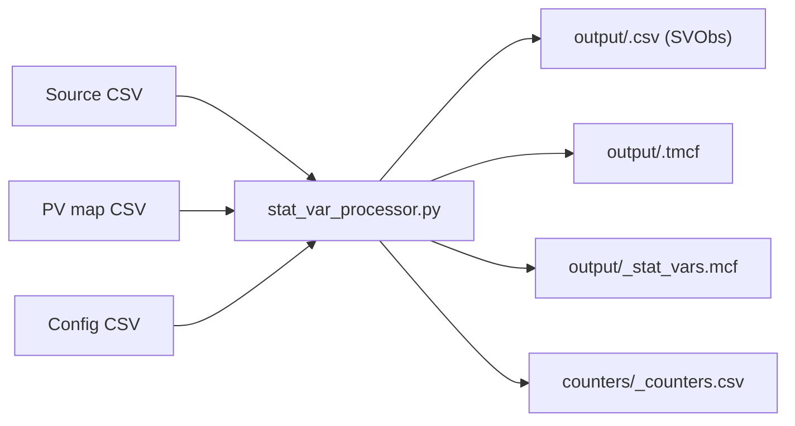

# StatVar Processor

`stat_var_processor.py` converts tabular source data into Data Commons
StatisticalVariables and observations, ready for the Data Commons import tool.

## Overview

The processor reads a data file, looks up each column header and cell in a
property-value map, and emits the import files. It uses these terms:

- **StatVar** (StatisticalVariable): what is measured, for example
  `Count_Person_Female`, defined by properties such as `populationType: Person`
  and `gender: Female`.
- **SVObs** (StatVarObservation): one value of a StatVar for a place and date.
- **PV map** (property-value map): a CSV file that maps text in the source data
  to Data Commons properties and values.
- **Config**: a CSV file with processing settings such as which rows are
  headers.
- **TMCF** (template MCF): maps the columns of the output CSV to SVObs
  properties.



## Quick reference

Follow these steps for every new import. Each step ends with a check that tells
you it is done:

1. **Inspect the input.** Give every column a role: place, date, label (a
   category such as gender), value, or ignore. *Done when* every column has a
   role.
1. **Write `<import>_pvmap.csv` and `<import>_statvar_processor_config.csv`.**
   See [Write a PV map](#write-a-pv-map) and [Write a config](#write-a-config).
   *Done when* every value column maps `value,{Number}` and the
   [mandatory properties](#mandatory-properties) are covered.
1. **Run on a sample** with `--input_rows=100` and
   `--output_counters=counters/<import>_counters.csv`. *Done when* the command
   exits with code 0 and every `dropped-*` counter is 0 or explained.
1. **Check the output.** Read the counters, then trace 3 output rows back to the
   source with the `#input` column. *Done when* every
   [success check](#check-the-results) holds.
1. **Run in full and lint.** *Done when* the output row count is about (data
   rows × value columns) minus intentional drops, you have reviewed
   `_stat_vars.mcf`, and `dc-import lint` reports no errors.

## Setup

Run these commands from the repository root:

1. Create the Python environment (installs `requirements_all.txt` into `.env/`):

   ```bash
   ./run_tests.sh -r
   ```

1. Set a Data Commons API key. The processor calls `api.datacommons.org` on
   every run, so it needs internet access. Without your own key it uses a shared
   key that can fail with `429 Too Many Requests`. Get a key from the
   [Data Commons API docs](https://docs.datacommons.org/api/#obtain-an-api-key).

   ```bash
   export DC_API_KEY=<your-key>
   ```

## Quick start

Run the bundled sample from the repository root:

```bash
./agents/common/run_python.sh tools/statvar_importer/stat_var_processor.py \
  --input_data=tools/statvar_importer/test_data/sample_input.csv \
  --pv_map=tools/statvar_importer/test_data/quickstart_pvmap.csv \
  --config_file=tools/statvar_importer/test_data/quickstart_statvar_processor_config.csv \
  --output_path=/tmp/svp/output/sample_output \
  --output_counters=/tmp/svp/counters/sample_counters.csv
```

The run writes these files:

- `/tmp/svp/output/sample_output.csv`: 12 observations.
- `/tmp/svp/output/sample_output.tmcf`: the template for the CSV.
- `/tmp/svp/output/sample_output_stat_vars.mcf`: 6 StatVars.
- `/tmp/svp/counters/sample_counters.csv`: processing counters.

The first rows of the CSV look like this:

```csv
observationDate,observationAbout,value,variableMeasured,#input
2020,geoId/6223,23456,dcid:Count_Person_25To30Years_WhiteAlone,tools/statvar_importer/test_data/sample_input.csv:4:5
2020,geoId/6223,10.1,dcid:Count_Person_25To30Years_WhiteAlone_AsAFractionOf_Count_Person,tools/statvar_importer/test_data/sample_input.csv:4:6
```

## Write a PV map

A PV map is a CSV file. The first column is a **key**: text that appears in the
source data. The remaining columns are property and value pairs that apply
wherever the key matches:

```csv
key,p1,v1,p2,v2,p3,v3
<text in the source>,<property>,<value>,<property>,<value>,...
```

### Walkthrough

This input is part of `test_data/sample_input.csv`:

| County             | Place Fips Code | Year | Person Age | Person Race | Total Persons |
| ------------------ | --------------- | ---- | ---------- | ----------- | ------------- |
| Kings County CA    | 6223            | 2020 | 25-30      | WH          | 23456.0       |
| Count of all Males |                 |      |            |             |               |
| Orange County CA   | 6123            | 2020 | 25-30      | A-PI        | 12345.0       |

This PV map handles it (from `test_data/quickstart_pvmap.csv`):

```csv
key,p1,v1,p2,v2,p3,v3
fips code,observationAbout,geoId/{Number}
year,observationDate,{Number}
25-30,age,25To30Years
wh,race,WhiteAlone
a-pi,race,AsianOrPacificIslander
males,gender,Male
total persons,value,{Number},populationType,Person,measuredProperty,count
```

The processor matches the keys like this:

| Source text              | Key             | Result                                                                       |
| ------------------------ | --------------- | ---------------------------------------------------------------------------- |
| Header `Place Fips Code` | `fips code`     | Each cell below sets `observationAbout`, e.g. `geoId/6223`                   |
| Header `Year`            | `year`          | Each cell below sets `observationDate`, e.g. `2020`                          |
| Cell `25-30`, `WH`       | `25-30`, `wh`   | Adds `age` and `race` to the values in that row                              |
| Row `Count of all Males` | `males`         | Adds `gender: Male` to the rows below it                                     |
| Header `Total Persons`   | `total persons` | Each cell below is an SVObs value of a StatVar with `populationType: Person` |

The first data row becomes the StatVar `Count_Person_25To30Years_WhiteAlone`
(properties `populationType: Person`, `measuredProperty: count`,
`age: 25To30Years`, `race: WhiteAlone`) with the observation
`2020, geoId/6223, 23456`.

### Matching rules

The processor applies keys with these rules:

1. **It looks up header text and cell text.** Column header PVs apply to every
   cell below the header. Cell PVs apply to the other values in the same row. A
   row with only a label, such as `Count of all Males`, applies to the rows
   below it.
1. **Keys match whole words.** `man` doesn't match `woman`.
1. **The longest matching key wins**, and keys that match different parts of the
   text combine: `total persons` and `males` can both apply.
1. **Lowercase keys match whole-cell text in any case**, so `total persons`
   matches `Total Persons` and `TOTAL PERSONS`. A key that matches a phrase
   *inside* longer text is case-sensitive, so copy the source casing (for
   example `pulmonary TB`).

### References and local variables

Values can refer to the cell being processed:

- `{Number}`: the numeric value of the cell, for example
  `observationDate,{Number}`.
- `{Data}`: the text of the cell, for example `observationAbout,country/{Data}`.
- Capitalized properties, such as `ProductName`, are local variables. Use them
  in other values (`{ProductName}`); they never appear in the output.

### Mandatory properties

Every StatVar needs `populationType` and `measuredProperty`. Every SVObs needs
`observationAbout`, `observationDate`, and `value`. The processor drops output
that lacks them.

### Dates

Map the date column directly: `year,observationDate,{Number}` for years, or
`date,observationDate,{Data}` for full dates. The processor normalizes common
formats to ISO 8601 (`YYYY`, `YYYY-MM`, `YYYY-MM-DD`).

### Drop data

Drop data in one of two ways:

- **Drop a whole row:** map a label in the row to `#ignore` with a reason, for
  example `tot,#ignore,total is computed in Data Commons`. Write `#ignore` in
  lowercase.
- **Drop a column:** comment out its row with a leading `#` and add a short
  reason, for example `#margin of error,value,{Number}` under
  `# moe not imported`. A column without a `value` mapping produces no
  observations.

NOTE: Keep comment rows short (a few words). Every row, comments included,
counts as a key, and long comments change how keys match.

Need filters, scaling, aggregation, or computed values? See
[Advanced processing](docs/advanced_processing.md). For the full PV map
reference, see [PV map guide](docs/pv_map.md). To find existing schema for a
label, see `schema_matcher.py` in [Tools](docs/tools.md). To generate a PV map
automatically, see [tools/agentic_import](../agentic_import/README.md).

## Write a config

The config is a two-column CSV with a `parameter,value` header. Quote values
that contain commas. A minimal config for a tidy CSV with one header row and the
label columns first looks like this:

```csv
parameter,value
import_name,us_county_population
url,https://www.example.gov/population-data
description,"County population by age, race, and gender"
release_frequency,annual
start_date,2010
end_date,2023
process,"Download the yearly CSV, then run the processor"
header_rows,1
mapped_columns,3
output_columns,"observationAbout,observationDate,variableMeasured,value,#input"
```

The first rows describe the import: its name, source URL, description, release
frequency, date range, and processing steps. Fill them in so reviewers
understand the source and the processing.

The processing settings work like this:

- `header_rows,1`: the first row holds column headers, and its text is looked up
  in the PV map.
- `mapped_columns,3`: cell values in the first 3 columns are looked up. Value
  cells in the other columns aren't. If you set neither `mapped_columns` nor
  `mapped_rows`, every cell is looked up.
- `output_columns`: the CSV columns, in order. Always set it so the CSV and TMCF
  stay the same across runs, and end it with `#input`. Add `unit`,
  `scalingFactor`, `measurementMethod`, or `observationPeriod` when your data
  sets them.
- `input_rows`: process only the first N rows. Use it for sample runs.

If your sheet has header rows inside the data, see `#Header` in
[Advanced processing](docs/advanced_processing.md). For other settings, see the
[advanced configuration](docs/config.md).

## Write PV maps that survive auto-refresh

Imports refresh automatically when the source publishes new data. Follow these
rules so new releases process without edits:

1. **Use lowercase keys for whole-cell text**, such as `total persons`, so a
   change in the source's capitalization still matches.
1. **Give every `#ignore` a reason**, such as
   `tot,#ignore,total is computed in Data Commons`.
1. **Add expected future keys now**: upcoming years, if years are keys, and
   places likely to appear.
1. **Split the PV map into reusable files**, for example a
   `<source>_places_pvmap.csv` shared by all tables from the same source plus a
   topic PV map per table. Pass both:
   `--pv_map=<source>_places_pvmap.csv,<table>_pvmap.csv`.
1. **Keep filters and date ranges explicit.** Don't hard-code a future-year
   cutoff, such as a filter that drops years after 2024.

## Map places

Put place mappings in a places PV map, `<source>_places_pvmap.csv`, that every
table from the same source can reuse:

```csv
key,p1,v1
# codes
iso3,observationAbout,country/{Data}
# names
kings county ca,observationAbout,geoId/06031
# georgia: US state chosen, the source lists US states
georgia,observationAbout,geoId/13
#georgia,observationAbout,country/GEO
```

- Map a column of codes with one pattern row, such as `country/{Data}` for ISO
  3166 alpha-3 codes.
- Map place names with one lowercase row per name.
- For an ambiguous name, keep the best candidate as the active row and list the
  other candidates as commented rows, with a short note on the choice.

To resolve many place names automatically, see the
[place tools](place/README.md).

## Add the processor to an import

Run the processor from the import's folder with the repository environment
active (`source <repo>/.env/bin/activate`):

```bash
python3 ../../tools/statvar_importer/stat_var_processor.py \
  --input_data=input_files/*.csv \
  --pv_map=<import>_pvmap.csv \
  --config_file=<import>_statvar_processor_config.csv \
  --existing_statvar_mcf=gs://unresolved_mcf/scripts/statvar/stat_vars.mcf \
  --output_path=output/<import> \
  --output_counters=counters/<import>_counters.csv
```

`--existing_statvar_mcf` reuses existing StatVars instead of creating
duplicates. Keep this folder layout:

- `input_files/`: downloaded source files, unchanged.
- `output/`: only the CSV, TMCF, and MCF files for the import tool.
- `counters/`: counters. Keep them out of `output/`, which the import tool reads
  as a whole.

Add the command to the import's `manifest.json`:

```json
"scripts": [
  "../../tools/statvar_importer/stat_var_processor.py --input_data=input_files/*.csv --pv_map=<import>_pvmap.csv --config_file=<import>_statvar_processor_config.csv --existing_statvar_mcf=gs://unresolved_mcf/scripts/statvar/stat_vars.mcf --output_path=output/<import> --output_counters=counters/<import>_counters.csv"
],
"import_inputs": [
  {
    "template_mcf": "output/<import>.tmcf",
    "cleaned_csv": "output/<import>.csv",
    "node_mcf": "output/*.mcf"
  }
],
"source_files": [
  "input_files/*.csv",
  "counters/*.csv",
  "*_pvmap.csv",
  "*_statvar_processor_config.csv"
]
```

List counters, PV maps, and configs in `source_files`: they are kept with each
import version only if listed, and you need them to debug a refresh. For
validation rules that run on each refresh (`validation_config_file`), see
[Import validation](../import_validation/README.md).

NOTE: Existing imports name the config `*_metadata.csv`. It has the same format
and still works.

## Check the results

The processor writes these files:

| File                                   | Contents                                                                            |
| -------------------------------------- | ----------------------------------------------------------------------------------- |
| `output/<import>.csv`                  | One row per SVObs.                                                                  |
| `output/<import>.tmcf`                 | Maps the CSV columns to SVObs properties.                                           |
| `output/<import>_stat_vars.mcf`        | New StatVars. It is short or empty when the StatVars already exist in Data Commons. |
| `output/<import>_stat_vars_schema.mcf` | New schema, such as enum values, that the StatVars use.                             |
| `counters/<import>_counters.csv`       | Counts of rows read, dropped, and written.                                          |

A run succeeds when all of these hold:

- The command exits with code 0.
- `output-svobs-csv-rows` is greater than 0 and close to the expected count.
- Every `dropped-*` counter is 0 or explained.
- `input-rows-ignored-*` counts only lines you expect to skip, such as titles
  and footers.
- No output node has an `#Error...` property.
- `dc-import lint` reports no errors.

Check these counters first. Some names carry a stage prefix, such as
`1:process_input_dropped-svobs-invalid`.

| Counter                                                           | Question it answers                                         |
| ----------------------------------------------------------------- | ----------------------------------------------------------- |
| `input-rows-processed`, `input-rows-ignored-*`                    | Were all data rows read?                                    |
| `dropped-svobs-unresolved-place`, `dropped-svobs-unresolved-date` | Were observations dropped for a missing place or date?      |
| `dropped-svobs-invalid`, `dropped-svobs-with-invalid-statvar`     | Were observations dropped for missing mandatory properties? |
| `output-svobs-csv-rows`                                           | How many observations were written?                         |

`error-unresolved-place` also counts header and section rows, so a nonzero value
alone isn't a problem.

To trace an output row, read its `#input` column, for example
`sample_input.csv:4:5` (file, line 4, column 5).

To lint the output, download
`datacommons-import-tool-<version>-jar-with-dependencies.jar` from the
[import tool releases](https://github.com/datacommonsorg/import/releases) and
pass the output files:

```bash
java -jar datacommons-import-tool.jar lint -o lint_report \
  output/*.csv output/*.tmcf output/*.mcf
```

Open `lint_report/summary_report.html`, or `lint_report/report.json`, and fix
every error. Review the warnings.

Need readable StatVar names? See the tip in [Tools](docs/tools.md).

## Common problems

| Symptom                                                                | Likely cause                                                                                 | Fix                                                                       |
| ---------------------------------------------------------------------- | -------------------------------------------------------------------------------------------- | ------------------------------------------------------------------------- |
| The CSV has no rows or too few rows                                    | A value column has no `value,{Number}` mapping, or `header_rows` / `mapped_columns` is wrong | Map the value column. Check that `header_rows` points at the header row.  |
| `dropped-svobs-unresolved-place`                                       | `observationAbout` is missing or isn't a DCID                                                | Map the place column; see [Map places](#map-places).                      |
| `error-statvar-missing-property`, `dropped-svobs-with-invalid-statvar` | The StatVar lacks `populationType` or `measuredProperty`                                     | Add the property to the value column's PV map row.                        |
| `error-svobs-missing-property`, `dropped-svobs-invalid`                | The SVObs lacks `observationDate`, `observationAbout`, or `value`                            | Map the date, place, and value columns.                                   |
| `error-statvar-with-dup-svobs`, a StatVar missing                      | Two rows produce the same StatVar, place, and date with different values                     | Add the missing distinguishing property, such as `gender`, to the PV map. |
| High `warning-missing-property-key`, properties missing                | A key doesn't match the source text                                                          | Check spelling and casing (rule 4), and keep comment rows short.          |

For more, see [Troubleshooting](docs/troubleshooting.md).

## Related tools and docs

| Task                                                               | Where                                                                             |
| ------------------------------------------------------------------ | --------------------------------------------------------------------------------- |
| PV map reference                                                   | [PV map guide](docs/pv_map.md)                                                    |
| Filters, scaling, aggregation, defaults, large inputs              | [Advanced processing](docs/advanced_processing.md)                                |
| All config settings                                                | [Advanced configuration](docs/config.md)                                          |
| A run produced fewer rows than expected                            | [Troubleshooting](docs/troubleshooting.md)                                        |
| Resolve many place names                                           | [Place tools](place/README.md)                                                    |
| Find existing schema, generate StatVar names, compare or merge MCF | [Tools](docs/tools.md)                                                            |
| Generate a PV map automatically                                    | [tools/agentic_import](../agentic_import/README.md)                               |
| Review an import change before a pull request                      | [dc-import-code-review skill](../../agents/skills/dc-import-code-review/SKILL.md) |
| Diagnose a failed or changed production refresh                    | [dc-import-diagnostics skill](../../agents/skills/dc-import-diagnostics/SKILL.md) |
| Validation rules for auto-refresh                                  | [Import validation](../import_validation/README.md)                               |
| Run the unit tests                                                 | `./run_tests.sh -p tools/statvar_importer`                                        |
